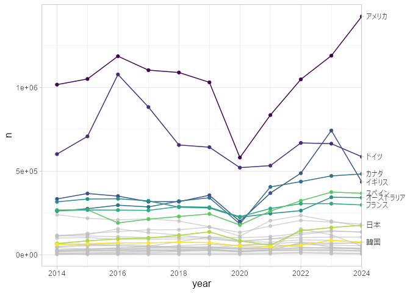
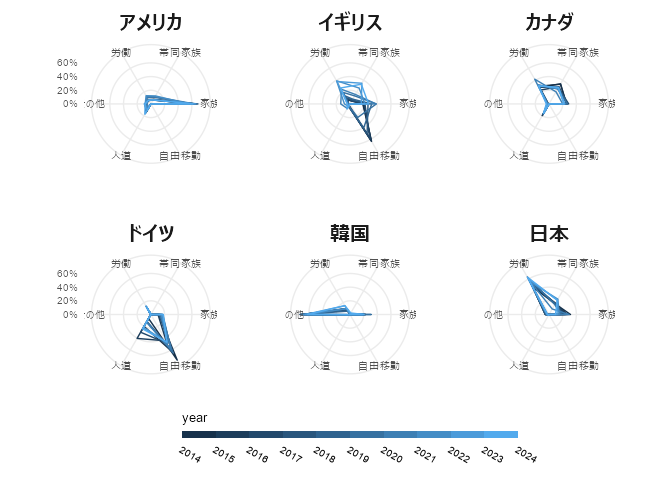

# Standardised inflows of permanent-type migrants


Data source: “Standardised inflows of permanent-type migrants” by OECD
(Last updated: November 03, 2025)

``` r
library(dplyr, warn.conflicts = FALSE)
library(ggplot2)
library(forcats)

d <- readr::read_csv(
  "data/OECD.ELS.IMD,DSD_MIG_INT@DF_MIG_INT_PER,1.0,complete,2026-10-17 15-19-58.csv"
)
```

    Registered S3 method overwritten by 'bit64':
      method          from 
      print.bitstring tools

    Rows: 1882 Columns: 24
    ── Column specification ────────────────────────────────────────────────────────
    Delimiter: ","
    chr (18): STRUCTURE, STRUCTURE_ID, STRUCTURE_NAME, ACTION, REF_AREA, Referen...
    dbl  (4): TIME_PERIOD, OBS_VALUE, UNIT_MULT, DECIMALS
    lgl  (2): Time period, Observation value

    ℹ Use `spec()` to retrieve the full column specification for this data.
    ℹ Specify the column types or set `show_col_types = FALSE` to quiet this message.

``` r
unique(d$`Reference area`)
```

     [1] "Belgium"         "Czechia"         "Estonia"         "Finland"        
     [5] "France"          "Germany"         "Israel"          "Italy"          
     [9] "Lithuania"       "Luxembourg"      "Mexico"          "Netherlands"    
    [13] "Norway"          "Portugal"        "Slovak Republic" "Slovenia"       
    [17] "Spain"           "Switzerland"     "Ireland"         "Sweden"         
    [21] "New Zealand"     "Canada"          "Japan"           "Korea"          
    [25] "United Kingdom"  "United States"   "Australia"       "Denmark"        
    [29] "Austria"        

``` r
d_summarised <- d |>
  group_by(
    area = recode(
      `Reference area`,
      "Belgium" = "ベルギー",
      "Czechia" = "チェコ",
      "Estonia" = "エストニア",
      "Finland" = "フィンランド",
      "France" = "フランス",
      "Germany" = "ドイツ",
      "Israel" = "イスラエル",
      "Italy" = "イタリア",
      "Lithuania" = "リトアニア",
      "Luxembourg" = "ルクセンブルク",
      "Mexico" = "メキシコ",
      "Netherlands" = "オランダ",
      "Norway" = "ノルウェー",
      "Portugal" = "ポルトガル",
      "Slovak Republic" = "スロバキア",
      "Slovenia" = "スロベニア",
      "Spain" = "スペイン",
      "Switzerland" = "スイス",
      "Ireland" = "アイルランド",
      "Sweden" = "スウェーデン",
      "New Zealand" = "ニュージーランド",
      "Canada" = "カナダ",
      "Japan" = "日本",
      "Korea" = "韓国",
      "United Kingdom" = "イギリス",
      "United States" = "アメリカ",
      "Australia" = "オーストラリア",
      "Denmark" = "デンマーク",
      "Austria" = "オーストラリア"
    ),
    year = TIME_PERIOD,
    type = fct_recode(
      `Entry category`,
      "その他" = "Other",
      "自由移動" = "Free movements",
      "労働" = "Work",
      "人道" = "Humanitarian",
      "家族" = "Family",
      "帯同家族" = "Accompanying family of workers",
    )
  ) |>
  summarise(n = sum(OBS_VALUE, na.rm = TRUE), .groups = "drop")
```

## Number of Migrants

``` r
d_by_country <- d_summarised |>
  summarise(n = sum(n), .by = c(area, year)) |>
  mutate(area = fct_reorder(area, n, .desc = TRUE))

ggplot(d_by_country, aes(year, n, colour = area)) +
  geom_line() +
  geom_point() +
  gghighlight::gghighlight(
    area %in%
      c(
        "アメリカ",
        "ドイツ",
        "カナダ",
        "イギリス",
        "スペイン",
        "オーストラリア",
        "フランス",
        "韓国",
        "日本"
      ),
    line_label_type = "sec_axis"
  ) +
  scale_color_viridis_d() +
  theme_light() +
  theme(
    text = element_text(size = 12)
  )
```

    Warning: Tried to calculate with group_by(), but the calculation failed.
    Falling back to ungrouped filter operation...
    Tried to calculate with group_by(), but the calculation failed.
    Falling back to ungrouped filter operation...

    label_key: area



## Migration Reasons

``` r
d_pct <- d_summarised |>
  filter(
    area %in%
      c(
        "アメリカ",
        "ドイツ",
        "イギリス",
        "カナダ",
        "韓国",
        "日本"
      )
  ) |>
  mutate(`%` = n / sum(n), .by = c(area, year))

ggplot(d_pct, aes(type, `%`, colour = year, group = factor(year))) +
  geom_polygon(fill = NA) +
  see::coord_radar() +
  facet_wrap(vars(area)) +
  scale_y_continuous(labels = scales::label_percent()) +
  scale_colour_binned(breaks = 2014:2025) +
  theme_minimal() +
  theme(
    text = element_text(size = 10),
    axis.title = element_blank(),
    strip.text = element_text(size = 15, face = "bold"),
    legend.position = "bottom",
    legend.title.position = "top",
    legend.text = element_text(angle = -30, hjust = 0),
    legend.key.width = unit(0.1, "npc"),
    legend.key.height = unit(0.015, "npc"),
    panel.spacing = unit(0.1, "npc"),
  )
```


